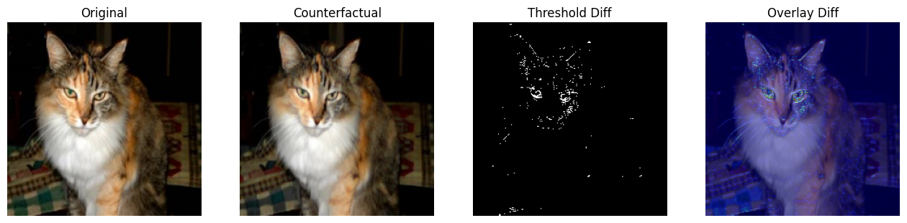

# Counterfactual Explainability for Image Classification

What changes in a pet photograph would make ResNet18 predict a different breed? This IIT Hyderabad computer vision project fine-tunes a classifier on 37 cat and dog breeds, then optimizes the pixels of a test image toward a different breed prediction.

[Training and analysis notebook](CV.ipynb) · [Project report (PDF)](project-report.pdf)

The overlay shows the size of the pixel changes made by the optimizer. The threshold panel highlights pixels whose change exceeds 20% of the largest change in that image.

## Classification results

We fine-tuned an ImageNet-pretrained ResNet18 for three epochs using the Oxford-IIIT Pet dataset's official training and test splits. The dataset contains about 7,300 images in total. We resized each image to 224 × 224 and trained using Adam with a batch size of 32 and a learning rate of 0.0001.

| Source | Test accuracy |
| --- | ---: |
| Saved notebook output | 87.52% |
| Course report | 87.49% |

## Counterfactual experiment

For a given test image, the notebook selects a target breed different from the original prediction. Adam updates the input pixels while keeping the classifier weights fixed. The objective combines target-class cross-entropy, an L1 penalty on changes from the original image, a smoothness penalty, and a penalty based on a 5 × 5 blur.

In the saved 800-step example, the prediction changed from class 16 to the selected target, class 6. A separate five-image experiment visualizes changes after 300 steps per image. It produces difference maps, threshold masks, and overlays for inspecting where the image changed.

**Implementation detail.** On the notebook's batch × channel × height × width tensors, the smoothness function takes differences along height and channel. The report describes the standard spatial total-variation term along height and width.

## Run the notebook

Open CV.ipynb in Google Colab or Jupyter. If needed, install the dependencies in a new notebook cell:

    %pip install torch torchvision matplotlib numpy scikit-learn seaborn

Run the cells in order. The first run downloads the dataset and pretrained weights. A CUDA GPU is recommended for training and pixel optimization. Random initialization of the classification head, shuffled training batches, and random image and target selection can change the results between runs.

## Authors

Jatavath Ajay . Puli Dinesh · Rathod Sai Dhanush  
Computer Vision course, IIT Hyderabad, March 2026
